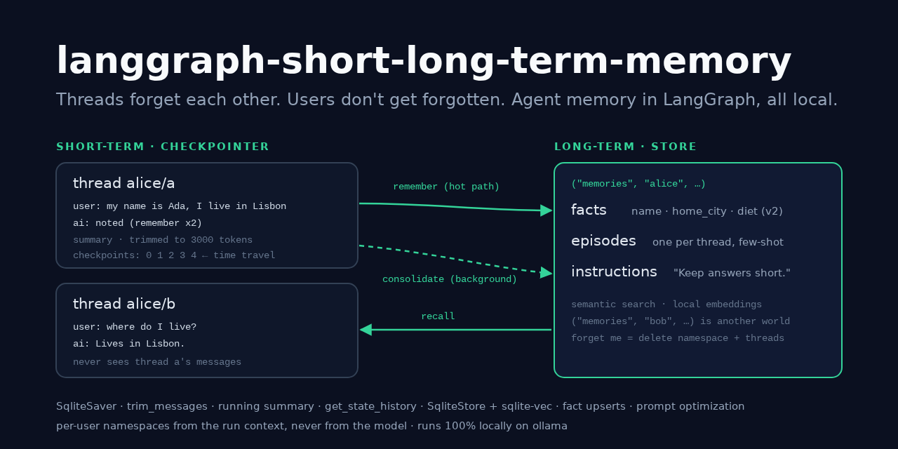
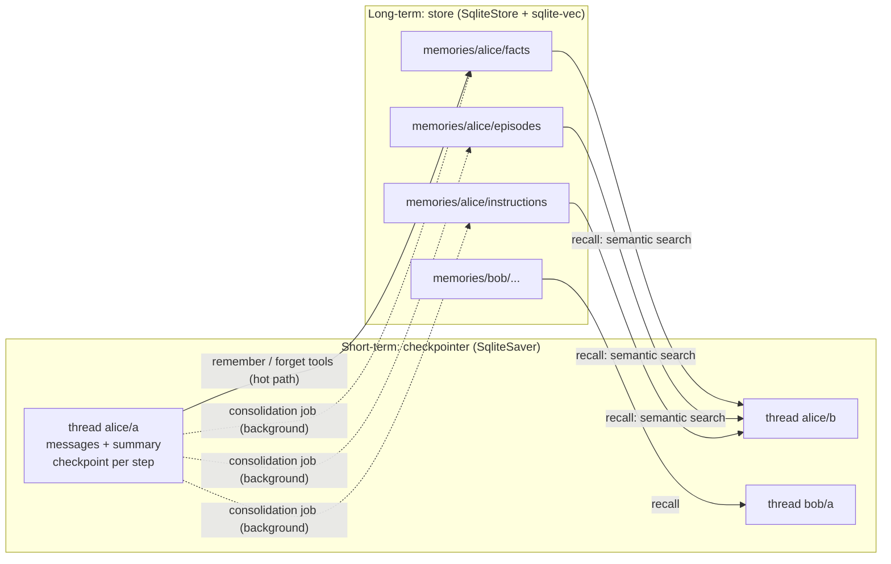
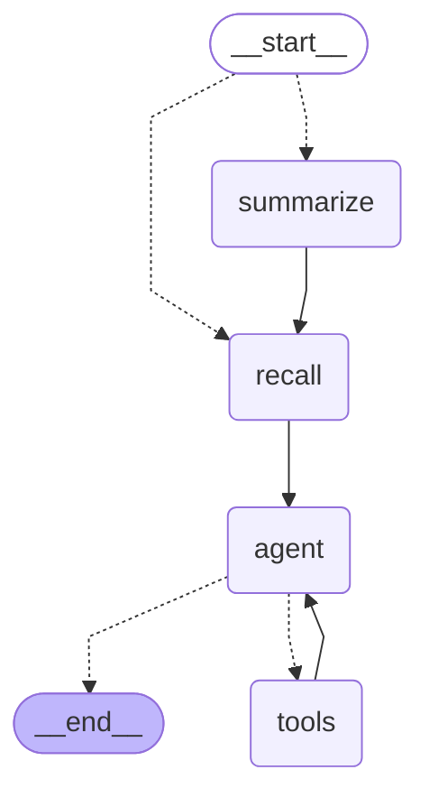
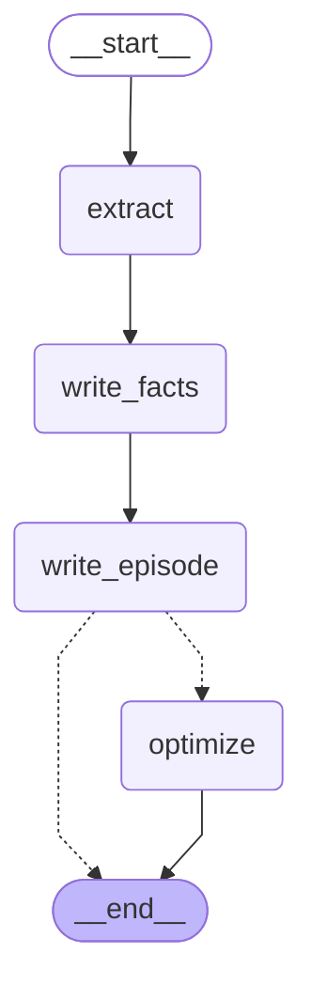

# langgraph-short-long-term-memory

> Agent memory in LangGraph, short-term vs long-term, side by side. A personal assistant
> whose **thread history** lives in a SQLite checkpointer (trimmed to a token budget,
> folded into a running summary, isolated per thread, with time travel) and whose
> **knowledge of the user** lives in a semantic store namespaced per user: facts that
> update instead of duplicating, episodes recalled as examples, and style rules the
> agent rewrites from feedback. Written on the hot path by tools, or in the background
> by a consolidation job. One call wipes it all ("forget me").

[](https://github.com/MartinCastroAlvarez/langgraph-short-long-term-memory/actions/workflows/ci.yml)
[](LICENSE)
[](pyproject.toml)
[](https://github.com/langchain-ai/langgraph)
[](pyproject.toml)



**Runs 100% locally, no paid APIs required.** The default chat model is an open-weight
model on [ollama](https://ollama.com) (`qwen3:4b`) through `langchain-ollama`, and the
store's embeddings come from ollama too (`nomic-embed-text`), or from
[fastembed](https://github.com/qdrant/fastembed) on the CPU with no server. Both
memories are SQLite files on your disk. Anthropic is an optional adapter you can switch
on with your own key. Tests, the demo and CI use a scripted fake chat model and a
deterministic hashing embedder: no model, no key, no network.

## Why

- **"Memory" is two different things.** What was said *in this conversation* and what
  the agent knows *about this person* have different scopes, lifetimes, storage, write
  paths and failure modes. LangGraph gives each its own primitive: a **checkpointer**
  (state per thread) and a **store** (documents per namespace, shared across threads).
  This repo uses both in one small agent so the difference is concrete.
- **A context window is a budget.** Long threads must be cut. Trimming is free but
  forgets; summarizing keeps the gist for one model call. Here both run, and a test
  proves no model call ever exceeds the budget.
- **Long-term memory rots unless writes are careful.** "I moved to Porto" must *update*
  the city, not add a second one; re-running the background job must change nothing; an
  old thread must not overwrite a newer fact. Each of these is a test.
- **Memory is personal data.** Namespaces come from the authenticated user, never from
  the model; recalled memories are untrusted text in the prompt; secrets are never
  stored; and "forget me" deletes the namespace *and* every checkpoint.

## Quickstart

```bash
pip install "langgraph-short-long-term-memory @ git+https://github.com/MartinCastroAlvarez/langgraph-short-long-term-memory"
ollama pull qwen3:4b && ollama pull nomic-embed-text
python -m memory_agent --user alice --thread a "Hi! My name is Ada and I live in Lisbon."
python -m memory_agent --user alice --thread b "What do you know about me?"
python -m memory_agent --provider fake --demo     # the two-thread demo, offline
```

Each call is one turn; both memories persist in `.memory/` (`threads.db` is the
checkpointer, `memories.db` the store). `--memories` prints what the store knows about
the user, `--history` lists a thread's checkpoints, `--fork <id> "..."` and
`--replay <id>` time-travel, `--forget-me` wipes the user, `--mermaid chat|consolidate`
prints a graph. `python -m examples.quickstart` runs the demo offline and checks it.

## The demo: what crosses threads, and what doesn't

`python -m memory_agent --provider fake --demo`, a real run with the fake model (it
answers from whatever is in its context window, so its answers show what each memory
let through):

~~~text
-- thread a: Alice introduces herself (hot path: the remember tool)
alice/a > Hi! My name is Ada and I live in Lisbon.
        < Noted (Memory added: The user's name is Ada; Memory added: Lives in Lisbon).  [tools: remember, remember]
alice/a > I'm vegetarian, and my favorite programming language is Rust.
        < Noted (Memory added: Is vegetarian; Memory added: Favourite programming language is Rust).  [tools: remember, remember]
alice/a > Please keep your answers short.
        < Understood. I'll answer that way from now on.

-- background job: consolidate thread a (facts, episode, style rules)
consolidated a: unchanged name, unchanged home_city, unchanged diet, unchanged favorite_language; rules=['Keep your answers short.']

-- thread b: a new conversation, same user
alice/b > What do you know about me?
        < What I remember: The user's name is Ada; Lives in Lisbon; Is vegetarian; Favourite programming language is Rust.
alice/b > Actually, I moved to Porto.
        < Noted (Memory updated: Lives in Porto).  [tools: remember]
alice/b > Where do I live?
        < Lives in Porto.
alice/b > What did I say earlier in this conversation?
        < Earlier in this conversation you said: What do you know about me; Actually, I moved to Porto; Where do I live.
alice/b > Explain what a checkpointer does.
        < Happy to help with that: Explain what a checkpointer does.

-- back to thread a, and another user
alice/a > What did I say earlier in this conversation?
        < Earlier in this conversation you said: Hi! My name is Ada and I live in Lisbon; I'm vegetarian, and my favorite programming language is Rust; Please keep your answers short; What did I say earlier in this conversation.
bob/a > What do you know about me?
      < I don't know that yet. Tell me and I'll remember.

checks:
  [ok] thread a remembers its own history
  [ok] facts from thread a are recalled in thread b
  [ok] a changed fact is updated, not duplicated
  [ok] thread b's history doesn't include thread a
  [ok] thread a's history doesn't include thread b
  [ok] style learned in thread a applies in thread b
  [ok] another user sees nothing
  [ok] forget me wipes the store namespace
  [ok] forget me wipes the checkpoints
  [ok] forget me leaves other users alone
~~~

The background job found nothing new to write (the hot path had already stored the
facts: `unchanged`, not duplicated), but it did turn "keep your answers short" into a
style rule, which is why thread b's explanation is one sentence. Bob's thread is also
called `a`; it is a different thread, because checkpointer thread ids are
`"<user>/<thread>"`.

## Short-term vs long-term memory



| | Short-term (thread) | Long-term: semantic | Long-term: episodic | Long-term: procedural |
| --- | --- | --- | --- | --- |
| **Holds** | this conversation's messages, a running summary | facts about the user (name, city, diet...) | one summary per past conversation | the agent's style rules for this user |
| **Scope** | one thread of one user | one user, every thread | one user, every thread | one user, every thread |
| **Lifetime** | until the thread is deleted; summarized past a token budget | until updated, forgotten or "forget me" | until overwritten by a re-consolidation of the thread, or "forget me" | until rewritten from feedback, or "forget me" |
| **Storage** | checkpointer: `SqliteSaver`, one checkpoint per step | store: `("memories", user, "facts")`, key = slot | `("memories", user, "episodes")`, key = thread | `("memories", user, "instructions")`, key `style` |
| **Write path** | every node's state update (`add_messages`, `RemoveMessage`) | hot: `remember`/`forget` tools; background: memory writer (structured output) | background: episode writer | background: optimizer, only when feedback was given |
| **Read path** | the whole state, trimmed to `max_context_tokens` before each call | `recall` node: semantic search on the new message (top `recall_facts`) | `recall` node: semantic search (top `recall_episodes`), shown as examples | `recall` node: always, as the `style` block |
| **Failure modes** | context overflow; trimming silently drops early facts; a lossy summary; tool call split from its result | duplicates; a stale write overwriting a newer fact; wrong extraction; prompt injection stored as a "fact" | irrelevant examples steering answers; leaking a past conversation's details | feedback drift (rules accumulate or contradict); a rule that tries to change safety behaviour |
| **Mitigation here** | budget enforced in code (`fit_to_budget`), summary at a threshold, cuts only at human turns | slot keys + similarity dedup; consolidation watermark; secret filter; `<data>` blocks | one per thread, capped text, untrusted `<data>` block | max 10 rules × 200 chars, deduplicated; the fixed rules come first and win |
| **Time travel** | yes: `get_state_history`, replay, fork | no: the store is not versioned (a fact keeps its last 5 values in `history`) | no | no (`version` counter only) |

## How it works

### The chat graph

`python -m memory_agent --mermaid chat`, pasted unchanged:



- **`summarize`** runs only when the thread's messages exceed `summarize_after_tokens`.
  It keeps the newest turns that fit `keep_recent_tokens` (cut at a human message, so a
  tool call never loses its result), asks the model to merge the older ones into the
  running summary, and deletes them from the checkpoint with `RemoveMessage`.
- **`recall`** reads `runtime.context.user_id` and searches **only** that user's
  namespaces: facts and episodes by semantic similarity to the new message, plus the
  style rules. When the search returns fewer than `recall_facts` facts (a lexical store
  finds nothing for "what do you know about me?"), the most recent facts fill the rest.
- **`agent`** builds the system prompt: fixed rules first, then `style`, `facts`,
  `episodes` and `summary` as escaped `<data>` blocks. If that prompt is over 60% of
  the budget, episodes go first, then the lowest-ranked facts, then half the summary.
  Then `trim_messages` keeps the newest messages that fit `max_context_tokens`. With
  `write_mode` `hot` or `both` the model gets the `remember` and `forget` tools.

### The consolidation job

`python -m memory_agent --mermaid consolidate`:



After each turn the assistant **schedules** the thread (debounced: one pending job per
thread) and `run_pending()` runs the jobs when the conversation goes idle (the CLI and
`Assistant.open` do it on exit). The job reads only the messages it hasn't consolidated
before (a per-thread watermark of message ids), so an old thread can't overwrite a
newer fact, and a second run is a no-op:

- **`extract`** - the memory writer, `model.with_structured_output(MemoryUpdate)`: facts
  with a slot and an action (`upsert` or `delete`), plus feedback on style if any.
- **`write_facts`** - `upsert_fact`: a known slot is **updated** (`version + 1`, the old
  value kept in `history`); a fact without a slot updates the most similar fact when
  the cosine similarity is at least `dedup_threshold`, and is added otherwise; an
  identical fact is `unchanged`; anything that looks like a secret is `refused`.
- **`write_episode`** - an `Episode` (situation, approach, outcome) for the whole thread,
  recalled later as a worked example.
- **`optimize`** - only when there was feedback: the optimizer rewrites the style rules
  (procedural memory, LangMem's "prompt optimization", here per user and bounded).

Hot path or background? Hot-path writes are visible on the very next turn and cost the
user latency and a tool call the model must decide to make. Background writes cost
nothing in the conversation, see the whole thread, and can deduplicate and summarize,
but land later. `MEMORY_WRITE_MODE=hot|background|both` picks; the default is both.

### Time travel

Every step of the chat graph is a checkpoint. `history()` lists them newest first
(`get_state_history`), `replay(id)` re-runs the nodes that were pending at a checkpoint
(`invoke(None, {checkpoint_id})`), and `fork(id, text)` sends a different message from
a past checkpoint, which branches the thread: the old branch stays in the history.

```bash
python -m memory_agent --user alice --thread a --history
python -m memory_agent --user alice --thread a --fork 1f1d063d-601e-6a6b-bfff-bf6cfbfc6069 "Call me Grace."
```

Time travel rewinds **short-term memory only**: the store is not versioned, so a fact
written on the abandoned branch is still there. That's the main reason to keep
long-term writes deliberate.

## When to use this pattern / trade-offs

Use a **checkpointer** whenever a conversation spans more than one call: it is what makes
a graph resumable, interruptible (human-in-the-loop) and debuggable. Add a **store**
when the agent should know things about a person across conversations, and only then:
long-term memory is a product decision with privacy, correctness and cost attached.

| Choice | Gain | Cost |
| --- | --- | --- |
| Trimming only | free, predictable | early facts silently disappear |
| Running summary | keeps the gist of long threads | one model call per summarization; a summary can be wrong, and it is written to the checkpoint |
| Hot-path `remember` tool | the fact is usable on the next turn; the user sees it happen | the model must decide to call it; extra latency per turn |
| Background consolidation | no latency, whole-thread context, dedup and episodes | memories land later; one more job to run, monitor and keep idempotent |
| Slot-keyed facts | updates in place, no duplicates | the model must choose consistent slots |
| Semantic recall (embeddings) | finds "where do I live?" → "Lives in Porto" | an embedder to run; similarity is not relevance |
| Procedural memory | the agent adapts to each user | rules can drift; they must never touch safety |

Prefer [s3-agent-memory](https://github.com/MartinCastroAlvarez/s3-agent-memory) as the
store when you want memories as plain objects in S3 (or R2, SeaweedFS, MinIO, a
folder) with no database. It plugs in as an optional adapter:

```bash
pip install "s3-agent-memory[langgraph] @ git+https://github.com/MartinCastroAlvarez/s3-agent-memory"
MEMORY_STORE=s3+file:///tmp/memories python -m examples.quickstart    # or s3://bucket/prefix
```

That store ranks with BM25 rather than this package's embedder, so similarity-based
dedup and forgetting are weaker there; slot-keyed facts still update in place. CI runs
the demo on it.

## Configuration

| Variable | Default | Meaning |
| --- | --- | --- |
| `MEMORY_PROVIDER` | `ollama` | `ollama`, `anthropic` (optional extra + your key) or `fake` |
| `MEMORY_MODEL` | `qwen3:4b` / `claude-sonnet-5-5` | chat model id for the provider |
| `OLLAMA_HOST` | `http://127.0.0.1:11434` | must be loopback unless the next variable is `1` |
| `MEMORY_ALLOW_REMOTE_OLLAMA` | unset | `1` allows a non-loopback ollama |
| `MEMORY_TEMPERATURE` | `0` | sampling temperature |
| `MEMORY_EMBEDDINGS` | `ollama` (`hashing` with `fake`) | `ollama`, `fastembed` (optional extra) or `hashing` |
| `MEMORY_EMBED_MODEL` | `nomic-embed-text` / `BAAI/bge-small-en-v1.5` | embedding model |
| `MEMORY_EMBED_DIMS` | `768` / `384` / `256` | must match the embedding model |
| `MEMORY_WRITE_MODE` | `both` | `hot` (tools), `background` (consolidation job) or `both` |
| `MEMORY_MAX_CONTEXT_TOKENS` | `3000` | hard budget for one model call (system + messages) |
| `MEMORY_SUMMARIZE_AFTER_TOKENS` | `2000` | summarize when the thread's messages exceed this |
| `MEMORY_KEEP_RECENT_TOKENS` | `600` | recent conversation kept verbatim after a summary |
| `MEMORY_SUMMARY_MAX_CHARS` | `1500` | cap on the running summary |
| `MEMORY_RECALL_FACTS` | `5` | facts recalled per turn |
| `MEMORY_RECALL_EPISODES` | `2` | episodes recalled per turn |
| `MEMORY_DEDUP_THRESHOLD` | `0.9` | similarity at which a slotless fact updates an existing one |

Tokens are counted with `count_tokens_approximately` (about 4 characters per token):
model-agnostic and deterministic. For Anthropic, `pip install
"langgraph-short-long-term-memory[anthropic] @ git+…"`, then set `ANTHROPIC_API_KEY` and
`MEMORY_PROVIDER=anthropic`; embeddings stay local. LangSmith tracing stays off unless
you set `LANGSMITH_TRACING`.

```python
from memory_agent import Assistant, Settings

with Assistant.open(Settings.from_env(), threads="threads.db", memories="memories.db") as bot:
    bot.chat("alice", "a", "Hi! My name is Ada and I live in Lisbon.")
    bot.run_pending()                                   # the background job
    print(bot.chat("alice", "b", "Where do I live?").text)
    bot.forget_user("alice")                            # memories + checkpoints
```

`build_chat_graph(settings, model, checkpointer=..., store=...)` and
`build_consolidation_graph(settings, model, store=...)` return the compiled graphs if
you'd rather drive them yourself (`context=UserContext(user_id=...)`).

## Testing

```bash
poetry install && poetry run pytest          # 78 tests, 97% coverage, ~4 s, offline
```

The tests drive the real graphs, the real `SqliteSaver`, `SqliteStore` (with
sqlite-vec) and `InMemoryStore`, with `FakeAssistantModel` (a `BaseChatModel` that
supports `bind_tools` and `with_structured_output`) and `HashingEmbeddings`:

- **thread isolation:** two threads of one user never see each other's messages; the
  same thread name for two users is two threads; threads survive a restart;
- **user isolation:** hostile ids (`alice/../bob`, `*`, `alice.bob`...) never reach a
  namespace; a tool call carrying `user_id: "bob"` still writes to the current user;
  the tools' schemas expose no user id; another user's prompt never contains your facts;
- **token budget:** no model call over `max_context_tokens` across a long thread; the
  checkpoint stays near the trigger; the summary keeps the oldest turn; summary cuts
  never split a tool call from its result; the system prompt sheds memories to fit;
- **update, not duplicate:** slot updates bump the version and keep history; near
  duplicates update; re-running the job is a no-op; an old thread can't overwrite a
  newer fact; secrets are refused;
- **recall ranking:** the most similar fact ranks first, scores descend, `k` is
  respected, only the user's namespace is searched, and a lexical store is topped up;
- **time travel:** history order, fork branches and keeps the old branch, replay
  re-runs, finished turns refuse replay, other users' checkpoints are unreachable;
- **forget me:** store namespace, checkpoints and pending jobs are gone (also after a
  restart), other users untouched;
- **hygiene:** recalled text can't close its `<data>` block; no `eval`/`exec`/`pickle`/
  `subprocess`/`shell=` and no silenced lint or type findings in the package.

## Part of the series

| Repo | Framework | Architecture |
|---|---|---|
| [langgraph-parallel-agents](https://github.com/MartinCastroAlvarez/langgraph-parallel-agents) | LangGraph | Parallelization / map-reduce (fan-out, fan-in) |
| [langgraph-plan-and-execute](https://github.com/MartinCastroAlvarez/langgraph-plan-and-execute) | LangGraph | Planning (plan → execute → replan) |
| [langgraph-reflection-agent](https://github.com/MartinCastroAlvarez/langgraph-reflection-agent) | LangGraph | Reflection (Reflexion: draft → critique → revise) |
| ✅ **langgraph-short-long-term-memory** | LangGraph | Memory: short-term (checkpointer) vs long-term (store) |
| [adk-sequential-pipeline](https://github.com/MartinCastroAlvarez/adk-sequential-pipeline) | Google ADK | Sequential pipeline + generator↔critic loop |
| [adk-vertex-memory-bank](https://github.com/MartinCastroAlvarez/adk-vertex-memory-bank) | Google ADK | Long-term memory (Vertex AI Memory Bank) |
| [adk-vertex-vector-search](https://github.com/MartinCastroAlvarez/adk-vertex-vector-search) | Google ADK | Agentic RAG (Vertex AI Vector Search) |
| [crewai-hierarchical-planning](https://github.com/MartinCastroAlvarez/crewai-hierarchical-planning) | CrewAI | Hierarchical / supervisor with planning |
| [langchain-tag-agent](https://github.com/MartinCastroAlvarez/langchain-tag-agent) | LangChain | Tool-using ReAct agent with Table-Augmented Generation (TAG) |
| [langsmith-agent-evals](https://github.com/MartinCastroAlvarez/langsmith-agent-evals) | LangSmith + LangGraph | Evaluation / observability, LLM-as-judge critic |
| [agentic-architectures](https://github.com/MartinCastroAlvarez/agentic-architectures) | framework-free | Catalog: ReAct, router, sequential, parallel, loop, reflection, critic, planning, supervisor, swarm/handoff, debate, human-in-the-loop, memory |
| [s3-agent-memory](https://github.com/MartinCastroAlvarez/s3-agent-memory) | LangGraph store | Agent memory (long-term, S3) |
| [agent-model-router](https://github.com/MartinCastroAlvarez/agent-model-router) | — | Router |

More from the same author: [local-rag-ollama](https://github.com/MartinCastroAlvarez/local-rag-ollama) ·
[ui-review-agent](https://github.com/MartinCastroAlvarez/ui-review-agent) ·
[pytest-llm-evals](https://github.com/MartinCastroAlvarez/pytest-llm-evals) ·
[repo-graph-mcp](https://github.com/MartinCastroAlvarez/repo-graph-mcp) ·
[agent-lint](https://github.com/MartinCastroAlvarez/agent-lint) ·
[django-admin-mcp-api](https://github.com/MartinCastroAlvarez/django-admin-mcp-api).

## Contributing

See [`CONTRIBUTING.md`](CONTRIBUTING.md), [`ARCHITECTURE.md`](ARCHITECTURE.md),
[`SECURITY.md`](SECURITY.md) and the agent contract in [`CLAUDE.md`](CLAUDE.md).

## License

MIT © 2026 Martín Castro Álvarez. See [LICENSE](LICENSE).
